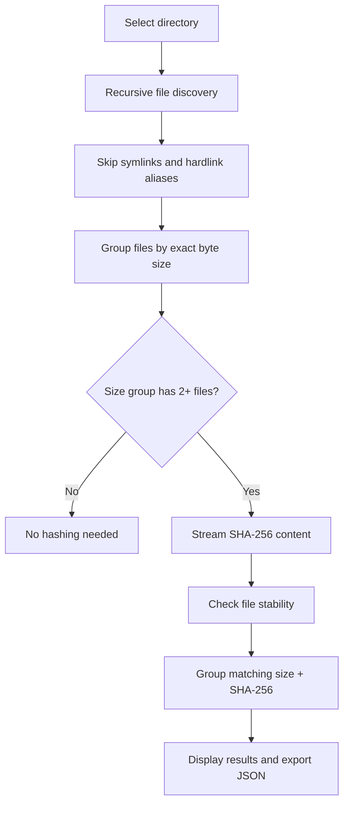

# FileDNA

**Find duplicate files by content, not by filename.**

FileDNA is a lightweight, read-only duplicate file finder for Windows with a clean desktop GUI and a scriptable CLI. It groups files by size first and only computes SHA-256 hashes for files that *could* be duplicates.

> **Status:** v0.1.0 source candidate. Windows executable build and test execution are reserved for the separate Hermes / Muse Spark validation stage. This is **not yet a verified release**.

## Features

- **Content-based detection:** different filenames, same bytes, same group.
- **Efficient scanning:** checks file sizes first and hashes only candidates, in 1 MiB streaming chunks.
- **Read-only operation:** never deletes, moves, renames, or modifies scanned files.
- **Windows-friendly GUI:** background scanning, cancel action, result groups, progress, and JSON export.
- **CLI and machine-readable JSON:** useful for automation and later integration.
- **Filesystem awareness:** skips symbolic links and does not treat additional hardlink names as new physical copies.
- **Basic race protection:** rejects files that change during scanning or hashing.
- **Transparent warnings:** unreadable files and folders are reported; scans with errors should not be treated as complete.

## Quick start

**Run the GUI directly (no third-party Python dependencies):**

```powershell
py -3 run.py
```

Or install the package in editable mode (requires setuptools):

```powershell
py -3 -m pip install -e .
filedna-gui
filedna "C:\Users\YourName\Downloads" --json report.json
```

**Command line without installation** (from the repo root):

```powershell
$env:PYTHONPATH = 'src'
py -3 -m filedna "C:\Users\YourName\Downloads" --json report.json
```

## How it works



The *potentially reclaimable* space is calculated as `size × (number of independent matching files − 1)` per group. This is an **estimate**, not a deletion instruction. FileDNA makes no determination about which copy should be retained.

## Project layout

```text
FileDNA/
├── run.py                    # GUI entry point / PyInstaller target
├── src/filedna/
│   ├── scanner.py            # Read-only duplicate-finding engine
│   ├── gui.py                # Tkinter desktop application
│   ├── cli.py                # CLI + report export
│   └── __main__.py           # python -m filedna
├── tests/                    # unittest coverage
├── scripts/
│   ├── test.ps1              # Windows testing script (for Hermes)
│   └── build.ps1             # Windows PyInstaller build (for Hermes)
└── pyproject.toml
```

## Testing & packaging (next stage: Hermes / Muse Spark)

These commands are **documented, but not yet executed or verified in this handoff**:

```powershell
.\scripts\test.ps1
.\scripts\build.ps1
```

Expected executable location once the build succeeds: `dist\FileDNA.exe`.

### Suggested acceptance checklist

- Same-content files with different filenames are grouped together.
- Files with the same size but different contents are not grouped.
- Empty files, nested folders, and unreadable files are handled.
- Symlink targets and hardlink aliases do not inflate reclaimable space.
- Cancel during hashing stops the scan without changing files.
- The GUI stays responsive during large scans.
- JSON contains groups, SHA-256, warnings, and totals.
- The Windows `.exe` launches without a console and can scan a sample directory.
- Compare `report.json` output from Python and the GUI export.
- Review permissions, UNC/network paths, long paths, and Unicode names.

## Limitations and safety

- **No cleanup action is offered.** Results are advisory; deleting duplicates safely is a separate problem.
- A successful SHA-256 match is extremely strong evidence of identical content, but the tool does not perform an additional byte-for-byte verification pass after hashing.
- Files can be changing while a directory is being traversed. FileDNA performs basic stat checks, not a filesystem snapshot; race conditions remain possible.
- Symbolic links are skipped. Hardlink aliases on the same device are skipped where inode information is available.
- Protected directories can produce access errors. Review the report's `errors` list before trusting the scan as exhaustive.
- Exported JSON can contain **full personal file paths**. Treat reports as private; do not post sample reports from your real machine publicly.
- Scanning external drives or network shares may be slow. Large files are streamed rather than loaded fully into memory.

## License

MIT License. See [LICENSE](LICENSE).

## Repository

Private GitHub repository: `canyrtcn/FileDNA`. Test and EXE build are reserved for the Hermes / Muse Spark stage.
