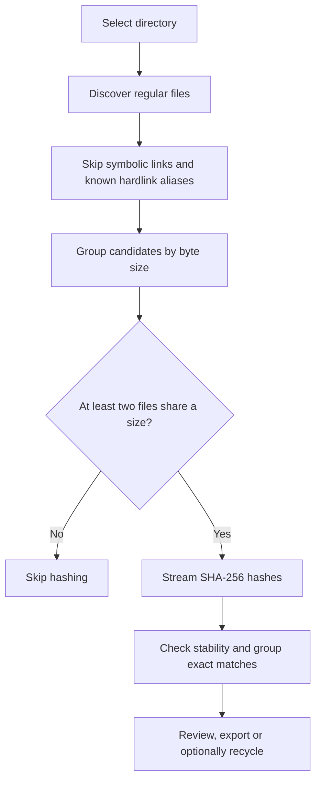

# FileDNA

[](https://github.com/canyrtcn/FileDNA/releases/latest)  [](LICENSE)  


**Find and manage exact duplicate files on Windows.**

FileDNA is a lightweight desktop utility that finds files with identical contents, even when their names or extensions differ. It uses size-based candidate selection and streaming SHA-256 hashing to identify matching files without modifying them during scanning.

The optional cleanup workflow requires an explicit selection and confirmation before moving files to the Windows Recycle Bin.

## Features

- **Content-based matching:** file size and SHA-256, independent of filename or extension.
- **Efficient scanning:** hashes only potential duplicates, using streaming reads instead of loading entire files into memory.
- **Read-only discovery:** scanning never moves, renames, or deletes files.
- **Review before cleanup:** duplicate groups, file paths, sizes and a potential space-recovery estimate.
- **Optional Recycle Bin cleanup:** deliberate selection and confirmation; no permanent-delete fallback.
- **Copy protection:** refuses to recycle every file in a duplicate group and verifies an unchanged matching copy before attempting cleanup.
- **Bulk operations:** Ctrl/Shift selection, selecting extra copies, right-click actions, copy paths and Explorer location.
- **Filter and export:** filter results by file path/name and export a structured JSON report.
- **Desktop interface:** compact graphite theme with amber accents, native dark title bar where supported, responsive scanning and progress.
- **Languages:** English and Turkish, switchable in the interface.
- **CLI:** scriptable scanning and JSON output.

## Getting started

**Requirements:** Windows, Python 3.10 or newer. The GUI uses Tkinter; the safe cleanup feature depends on [Send2Trash](https://github.com/arsenetar/send2trash).

From the project directory, install and launch:

```powershell
py -3 -m pip install -e .
filedna-gui
```

Alternatively, run the GUI from the source directory after installing dependencies:

```powershell
py -3 run.py
```

### Command line

```powershell
filedna --version
filedna "$env:USERPROFILE\Downloads" --json "filedna-report.json"
```

The path above uses a Windows environment variable rather than a machine-specific directory. JSON reports can contain **full paths to files on the scanned computer**. Keep reports private and avoid publishing real scan results.

## Desktop controls

| Action | Control |
| --- | --- |
| Select individual file rows | Ctrl + click |
| Select a contiguous range | Shift + click |
| Select extra copies while retaining one per visible group | Ctrl + A or **Select extras** |
| Open the context menu | Right-click a result |
| Copy selected file paths | Ctrl + C |
| Move selected copies to the Recycle Bin | Delete or context menu, followed by confirmation |
| Focus the results filter | Ctrl + F |
| Start another scan | F5 |
| Open Help | F1 or ? |

Double-clicking a file row opens its location in File Explorer. The result filter preserves entire duplicate groups so the full set of copies remains visible when a group matches.

### Cleanup safeguards

Cleanup is **off by default**. No file operation occurs during a scan or when the confirmation dialog is declined.

When cleanup is confirmed, FileDNA:

1. Rejects selections that include every file in any duplicate group.
2. Rechecks file contents and requires an unchanged SHA-256-matching copy to remain in the scanned folder.
3. Rejects unsafe paths, including symbolic links and junction-based traversal.
4. Uses the operating system's Recycle Bin through Send2Trash. It never falls back to permanent deletion.
5. Reports files that were moved and files that could not be moved, then refreshes the scan.

**Important:** The first path in a group is the default retained copy for automatic extra-copy selection. This does not establish which file is the preferred original. Review selections and keep backups of important data. Filesystem changes between final verification and the Recycle Bin operation cannot be eliminated completely.

Recycling may be unavailable on some external drives, network locations or protected folders. In those cases, the operation must fail rather than silently remove a file.

## How scanning works



*Potentially recoverable space* is an estimate of the storage occupied by extra independent copies. The estimate does not constitute a recommendation to delete particular files.

## Build and test

```powershell
.\scripts\test.ps1
.\scripts\build.ps1
```

The test and build scripts first run `scripts/check_repo.py`, a dependency-free safety check for obvious credentials, machine-specific paths and private/generated files among **tracked** source files. It requires a Git checkout and is not a historical-secret scanner. The test script then installs the project in a local virtual environment and runs the unittest suite. GUI tests require a graphical session. The build script generates application icon assets and uses PyInstaller to produce a standalone Windows executable:

```text
dist\FileDNA.exe
```

The executable and other generated build files are excluded from source control. A newly built executable should be tested on a disposable directory before use with important files.

### Project structure

```text
FileDNA/
├── assets/filedna.svg       # Icon source
├── run.py                   # Desktop entry point
├── scripts/                 # Testing, icon generation and packaging
├── src/filedna/
│   ├── scanner.py           # Read-only duplicate detection
│   ├── cleanup.py           # Confirmed, validated Recycle Bin cleanup
│   ├── gui.py               # Tkinter desktop interface
│   └── cli.py               # Command-line interface and report output
├── tests/                   # Unit and GUI integration tests
└── pyproject.toml
```

## Known limitations

- A successful SHA-256 match provides strong evidence of byte-identical content, but does not replace a filesystem snapshot or a separate byte-for-byte comparison.
- Open or changing files may be skipped. Permissions and unreadable paths can make a scan incomplete; inspect reported errors.
- Network shares and removable drives may have different filesystem or Recycle Bin behavior.
- Native Windows title-bar appearance may vary by Windows version and desktop theme.
- Machine-generated reports can reveal local directory structures; never upload private reports to issue trackers or public repositories.

## License

Licensed under the [MIT License](LICENSE).
