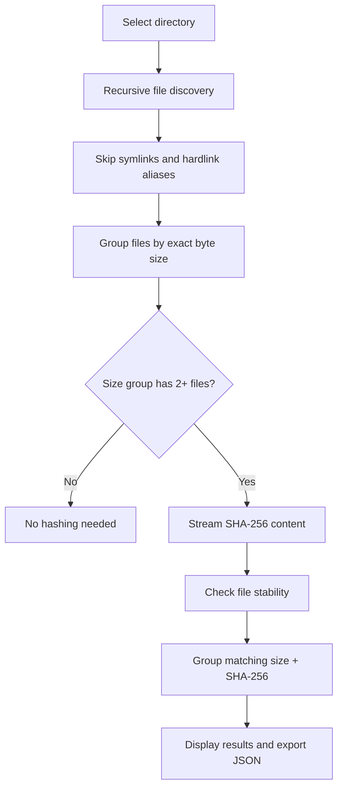

# FileDNA


**Find duplicate files by content, not by filename.**

FileDNA is a lightweight duplicate-file manager for Windows with a clean desktop GUI and a scriptable CLI. Scanning is **read-only**: it groups by size and hashes with SHA-256 only where needed. Optionally, users can **explicitly select** verified copies and move them to the system Recycle Bin after a confirmation dialog (no permanent-delete fallback).

> **Status:** v0.1.0 source candidate. Windows executable build and test execution are reserved for the separate Hermes / Muse Spark validation stage. This is **not yet a verified release**.

## Features

- **Content-based detection:** different filenames, same bytes, same group.
- **Efficient scanning:** checks file sizes first and hashes only candidates, in 1 MiB streaming chunks.
- **Read-only scanning:** automatic detection never changes files. The optional Recycle Bin action is manual, confirm-first, and preserves at least one independently verified copy in every group.
- **Windows-friendly GUI:** restrained graphite/amber theme with genuinely rounded Tk Canvas buttons, fields, metric cards, results panel and progress area; background scanning, cancellation, result groups and JSON export.
- **English-first interface:** EN by default, optional Turkish (TR) toggle; the alternate language appears as a smaller helper label.
- **Results workflow:** Ctrl/Shift multiselect, *Select extras* (Ctrl+A), right-click actions, select-by-group, copy file paths (Ctrl+C), case-insensitive filename/path filter, and single-file Explorer reveal.
- **Safe optional cleanup:** Delete/right-click prompts before sending chosen paths to Recycle Bin using Send2Trash. Rejects selection of a whole group, checks for an unchanged matching survivor and a valid target, blocks symlinks/junction traversal, and re-scans after the operation. Partial failures are reported.
- **Rounded UI:** native Tk Canvas-drawn shapes; no CustomTkinter or third-party GUI dependency. The results grid remains a native Treeview inside a rounded panel.
- **Native Windows dark title bar:** preserves standard minimize/maximize/close buttons while requesting a graphite caption/text color via DWM (`DWMWA_CAPTION_COLOR`, `DWMWA_TEXT_COLOR`) and immersive-dark fallback. Some Windows versions or themes may override it.
- **In-app Help (`?`):** concise four-step EN/TR instructions, report privacy notes, keyboard accessible, and language-aware while open.
- **CLI and machine-readable JSON:** useful for automation and later integration.
- **Project identity:** the desktop footer displays the version and clickable links to [@canyrtcn](https://github.com/canyrtcn) and the [FileDNA repository](https://github.com/canyrtcn/FileDNA).
- **Filesystem awareness:** skips symbolic links and does not treat additional hardlink names as new physical copies.
- **Basic race protection:** rejects files that change during scanning or hashing.
- **Transparent warnings:** unreadable files and folders are reported; scans with errors should not be treated as complete.

## Quick start

**Run the GUI from a source checkout:** install dependencies with `py -3 -m pip install -e .` before launching. Send2Trash is the only runtime third-party dependency; the interface itself uses standard-library Tkinter.

The Python interface uses Tkinter; without an icon build, the application shows a simple built-in fallback icon. The native Windows title-bar treatment uses `ctypes` and falls back to OS defaults when DWM coloring is not supported. The Windows build generates the complete FileDNA icon automatically.

```powershell
py -3 run.py
```

Or install the package in editable mode (requires setuptools):

```powershell
py -3 -m pip install -e .
filedna-gui
filedna --version
filedna "C:\Users\YourName\Downloads" --json report.json
```

**Command line without installation** (from the repo root):

```powershell
$env:PYTHONPATH = 'src'
py -3 -m filedna "C:\Users\YourName\Downloads" --json report.json
```

## Windows icon and standalone build

The amber vector icon source is [`assets/filedna.svg`](assets/filedna.svg). The deterministic Pillow-based generator `scripts/make_icon.py` creates matching PNG and ICO assets. `scripts/build.ps1` installs Pillow and PyInstaller as build-only dependencies, bundles the icon assets and explicitly collects Send2Trash's platform modules. No separate Python installation is required to run the bundled executable.

Run on Windows:

```powershell
.\scripts\test.ps1
.\scripts\build.ps1
```

Source-code tests can also be run with `python -m unittest discover -s tests -v`. GUI integration tests skip if no graphical display is available.

## About and links

The application window title and footer display the current version from `src/filedna/__init__.py` (currently `0.1.0`). Two footer links (including the visible username **@canyrtcn**) open the [GitHub author profile](https://github.com/canyrtcn) and the [private source repository](https://github.com/canyrtcn/FileDNA) in the default browser. The repository link requires a GitHub account with access while the project remains private.

## How it works



The *potentially reclaimable* space is calculated as `size × (number of independent matching files − 1)` per group. This is an **estimate**, not a deletion instruction. FileDNA makes no determination about which copy should be retained.

## Project layout

```text
FileDNA/
├── run.py                    # GUI entry point / PyInstaller target
├── src/filedna/
│   ├── scanner.py            # Read-only duplicate-finding engine
│   ├── gui.py                # Tkinter desktop application
│   ├── cleanup.py            # Opt-in validated Recycle Bin cleanup
│   ├── cli.py                # CLI + report export
│   └── __main__.py           # python -m filedna
├── tests/                    # unittest coverage
├── scripts/
│   ├── test.ps1              # Windows testing script (for Hermes)
│   ├── make_icon.py          # Generates PNG + ICO from vector-inspired geometry
│   └── build.ps1             # Windows PyInstaller build (for Hermes)
├── assets/filedna.svg       # Vector icon source
└── pyproject.toml
```

## Testing & packaging (next stage: Hermes / Muse Spark)

A previous amber/rounded build passed a Muse Spark validation report (39 passed, one OS-permission symlink skip). **The new selection, filter, native Treeview hover fix and user-confirmed Recycle Bin features require a NEW Windows validation and EXE build.** Previous screenshots or EXE hashes cannot verify the new code. Muse's earlier `Tcl_AsyncDelete` workaround was applied locally in test teardown; preserve these local changes until reconciled and rechecked. Required:

```powershell
.\scripts\test.ps1
.\scripts\build.ps1
```

Expected executable location once the build succeeds: `dist\FileDNA.exe`.

### Suggested acceptance checklist

- Same-content files with different filenames are grouped together.
- Files with the same size but different contents are not grouped.
- Empty files, nested folders, and unreadable files are handled.
- Symlink targets and hardlink aliases do not inflate reclaimable space.
- Cancel during hashing stops the scan without changing files.
- The GUI stays responsive during large scans.
- JSON contains groups, SHA-256, warnings, and totals.
- The Windows `.exe` launches without a console and can scan a sample directory.
- The taskbar/title bar display the newly generated **amber** FileDNA ICO, English is selected by default, TR switches labels, and GitHub @canyrtcn / Repository links work.
- Rounded buttons, controls, cards, table container and progress bar render without clipped labels at minimum size and Windows DPI 100%/125%; no unrounded blue legacy widgets remain.
- Windows 11 standard title bar visually matches the dark application (with functioning minimize/maximize/close). On unsupported systems it retains the OS title bar, without borderless emulation.
- The `?` Help is reachable with mouse and keyboard, explains usage in EN/TR and closes cleanly. Open Help while switching language.
- Repeat scans/cancellation do not reuse stale progress events; group labels update when switching EN/TR after results are present.
- Compare `report.json` output from Python and the GUI export.
- Right-click selection, Ctrl/Shift range selection, Ctrl+A (keep one), Ctrl+C and Delete all work in EN and TR.
- Test white hover/pressed heading behavior in Windows (including high contrast and inactive focus), dark context-menu colors and filter with all/no/multiple matches.
- Test that clicking Cancel performs no cleanup, attempting to recycle all copies of any group is rejected, changed/symlinked files are skipped, and any real OS recycling is tested **only on disposable temporary fixtures**.
- Confirm Send2Trash is bundled into `dist/FileDNA.exe` and the OS Recycle Bin receives test-only files rather than permanently deleting them.
- Review permissions, UNC/network paths, long paths, and Unicode names.

## Selecting and optionally recycling duplicates

1. Scan a folder. Select one or several file rows with Ctrl-click or Shift-click.
2. Use **Select extras / Ctrl+A** to select all but one copy in every **visible** matching group (use the filter field to narrow the groups).
3. Right-click to copy paths, select group extras, open file location, clear selection or choose **Move selected to Recycle Bin**. Pressing **Delete** offers the same recycle action.
4. Review the total file count/size in the warning and confirm. **No action occurs when you decline.**
5. FileDNA independently verifies an unselected matching survivor in each group and validates selected file contents before trying to recycle them. Unsupported recycle destinations return errors; the app never switches to permanent deletion.
6. When cleanup finishes, review moved/failed counts and the refreshed scan results. No files from the user's folder are recycled during automated tests (use mocks and isolated test fixtures).

## Limitations and safety

- **Automatic scanning is read-only.** Manual cleanup is explicitly opt-in and only moves user-confirmed selected files to the OS Recycle Bin. There is no permanent-delete option.
- The app protects at least one copy **per duplicate group**, but cannot guarantee atomic safety against files changing between final verification and OS recycling. Keep separate backups of important files.
- The first path in each group is used as the default retained copy for bulk selection; this is not necessarily the most valuable or newest original. Review selections carefully.
- Some drives, UNC shares and removable media cannot support recoverable recycling. Cleanup must fail and disclose the error instead of deleting permanently.
- Directly using Ctrl/Shift can include reference copies in the selection, but attempting to move *all* files of one group is rejected.
- A successful SHA-256 match is extremely strong evidence of identical content, but the tool does not perform an additional byte-for-byte verification pass after hashing.
- Files can be changing while a directory is being traversed. FileDNA performs basic stat checks, not a filesystem snapshot; race conditions remain possible.
- Symbolic links are skipped. Hardlink aliases on the same device are skipped where inode information is available.
- Protected directories can produce access errors. Review the report's `errors` list before trusting the scan as exhaustive.
- Exported JSON can contain **full personal file paths**. Treat reports as private; do not post sample reports from your real machine publicly.
- Scanning external drives or network shares may be slow. Large files are streamed rather than loaded fully into memory.

## License

MIT License. See [LICENSE](LICENSE). Packaging output, virtual environments, caches and local reports are excluded using [.gitignore](.gitignore).

## Repository

Private GitHub repository: [`canyrtcn/FileDNA`](https://github.com/canyrtcn/FileDNA). For the Hermes / Muse Spark verification stage on Windows, clone the repository to `C:\Hermes_Win\AgentWorkspace\FileDNA` before running `scripts/test.ps1` and `scripts/build.ps1`. Re-run these scripts after the amber redesign; a prior build validated the previous blue GUI only.
